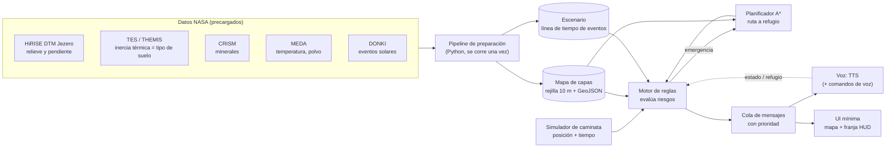

# Propuesta de MVP: asistente de voz para Marswalk en Jezero

**Reto:** NASA Space Apps 2026, "Interplanetary survival guide: Martian map"
**Objetivo del MVP:** mostrar, en una demo de 2 a 3 minutos, que un asistente montado en el casco puede combinar datos de la NASA y guiar por voz a un astronauta: avisos de riesgo, recomendaciones y una ruta de evacuación a un refugio.
**Enfoque:** audio primero. El HUD es mínimo.

Fuentes de datos: todas oficiales de la NASA, listadas en [fuentes-nasa-marte.md](fuentes/fuentes-nasa-marte.md).

---

## 1. Qué hace el MVP (y qué no)

**Sí hace**
- Simula una caminata por una ruta en Jezero (posición que avanza sobre el mapa).
- En cada paso revisa el terreno, el clima y el clima espacial alrededor del astronauta.
- Habla cuando hay algo importante: emergencia, advertencia o recomendación científica.
- Ante una emergencia calcula la ruta más segura al refugio más cercano y guía por voz ("gira a la derecha, 300 metros").
- Responde 2 o 3 comandos de voz simples ("estado", "¿dónde está el refugio?", "repite").

**No hace (fuera de alcance)**
- Datos en vivo desde Marte: todo está precargado y el escenario está guionizado.
- GPS real ni sensores reales: la posición viene de un archivo de ruta.
- HUD completo: solo una franja con 3 indicadores.

---

## 2. Arquitectura general



Son cinco piezas, cada una con una responsabilidad clara. Pueden repartirse entre integrantes del equipo.

| Pieza | Qué hace | Entrada | Salida |
|---|---|---|---|
| Pipeline de datos | Recorta y simplifica los datos NASA a la zona de la caminata | Archivos NASA | `mapa.json`, `escenario.json` |
| Simulador | Mueve al astronauta por la ruta y avanza el reloj | `ruta.geojson` | posición y tiempo, cada segundo |
| Motor de reglas | Decide si hay algo que decir | posición, tiempo, mapa, escenario | alertas con prioridad |
| Planificador A* | Busca la ruta más segura al refugio | mapa de costos, posición | lista de puntos + indicaciones |
| Voz + UI | Habla los mensajes y muestra el mapa | alertas | audio, mapa |

---

## 3. Pipeline de datos (se hace una sola vez, antes de la demo)

La idea es no trabajar con los archivos originales (algunos pesan cientos de MB), sino convertirlos en una **rejilla pequeña** de la zona de la caminata: unos 2 × 2 km alrededor del punto de partida, con celdas de 10 m (200 × 200 celdas). Cada celda guarda todas las capas.

| Capa | Fuente NASA | Cómo se procesa | Resultado por celda |
|---|---|---|---|
| Elevación y pendiente | HiRISE DTM `ESP_045994_1985` | Recortar con GDAL, remuestrear a 10 m, calcular pendiente (`gdaldem slope`) | `elev` (m), `pendiente` (°) |
| Tipo de suelo | TES o THEMIS, inercia térmica | Recortar y clasificar: baja = arena/polvo suelto, media = regolito, alta = roca | `suelo`: arena / regolito / roca |
| Minerales | CRISM, mapas de parámetros (MTRDR) | Marcar zonas con carbonatos o arcillas (interés científico) | `mineral`: ninguno / carbonato / arcilla |
| Clima | MEDA (Perseverance), CSV | Tomar un sol real y extraer temperatura y opacidad por polvo cada X minutos | serie de tiempo |
| Clima espacial | DONKI (API), un evento real de partículas solares (SEP) | Usar un evento real como "plantilla" del escenario | evento con hora de llegada |
| Refugios | A mano, sobre la ortoimagen HiRISE | 3 o 4 puntos: módulo de aterrizaje, salientes rocosos, bordes de cráter pequeños | `refugios.geojson` |
| Ruta de caminata | Waypoints de Perseverance (GeoJSON) o trazada a mano | Tomar un tramo real o dibujar uno | `ruta.geojson` |

**Simplificación honesta:** las capas tienen resoluciones muy distintas (HiRISE a 1 m, TES a kilómetros). Para el MVP basta con remuestrear todo a la misma rejilla y decirlo en la presentación.

**Herramientas:** Python con `rasterio`/GDAL, `numpy` y `pandas`. Salida: un `mapa.json` (o `.npz`) y los GeoJSON.

**Plan B si un archivo no descarga a tiempo:** usar la capa equivalente desde NASA Mars Trek, o generar esa capa sintética y marcarla como tal en la demo.

---

## 4. El escenario (la "historia" de la demo)

Un archivo `escenario.json` con eventos en el tiempo de la simulación. Permite que la demo sea repetible.

```json
[
  { "t": 20,  "tipo": "ciencia",   "dato": "carbonato cerca" },
  { "t": 50,  "tipo": "terreno",   "dato": "pendiente alta adelante" },
  { "t": 80,  "tipo": "polvo",     "opacidad": 1.8, "llegada_min": 20 },
  { "t": 85,  "tipo": "solar",     "evento": "SEP", "llegada_min": 30 },
  { "t": 140, "tipo": "fin" }
]
```

Los eventos de terreno y ciencia en realidad salen del mapa (el motor los detecta solo); el escenario se usa sobre todo para el clima y el evento solar, que en la vida real llegarían como avisos desde la base o un satélite.

---

## 5. Motor de reglas (el "cerebro")

Un ciclo que corre cada segundo:

```
para cada tic:
    pos = simulador.posicion()
    celda = mapa[pos]
    vecinas = mapa.alrededor(pos, radio=50 m, hacia_adelante=True)

    revisar reglas -> lista de alertas
    si hay emergencia y no hay ruta activa:
        ruta = astar(pos, refugio_mas_cercano)
    si hay ruta activa:
        generar siguiente indicación de navegación
    mandar alertas nuevas a la cola de voz
```

**Reglas del MVP** (umbrales simples, fáciles de explicar al jurado):

| Regla | Condición | Prioridad | Mensaje de ejemplo |
|---|---|---|---|
| Pendiente | pendiente > 15° en los próximos 50 m | Advertencia | "Pendiente fuerte adelante. Desvía a la izquierda." |
| Pendiente extrema | pendiente > 25° | Emergencia | "Alto. Terreno peligroso." |
| Suelo suelto | `suelo = arena` adelante | Advertencia | "Arena suelta adelante, riesgo de hundirte." |
| Tormenta de polvo | opacidad > 1.5 o aviso en el escenario | Emergencia | "Tormenta de polvo en 20 minutos. Ve al refugio." |
| Evento solar | aviso SEP de DONKI | Emergencia | "Alerta de radiación solar. Refugio en 30 minutos máximo." |
| Temperatura | < -80 °C o caída rápida | Advertencia | "Temperatura bajando rápido. Revisa calefacción del traje." |
| Ciencia | `mineral ≠ ninguno` a menos de 30 m | Info | "Afloramiento de carbonatos a 20 metros a tu derecha." |

**Para no saturar al astronauta:**
- No repetir la misma alerta en menos de 60 s.
- Una emergencia interrumpe cualquier otro mensaje.
- Mientras hay emergencia activa, solo se dicen mensajes de navegación.

---

## 6. Planificador de ruta de evacuación (A*)

- **Grafo:** la misma rejilla de 10 m; cada celda conecta con sus 8 vecinas.
- **Costo de moverse a una celda:**
  `costo = distancia × (1 + k1·pendiente + k2·[suelo = arena])`
  y celdas con pendiente > 25° son **intransitables**.
- **Destino:** se corre A* hacia cada refugio y se elige el de menor costo total (no el más cercano en línea recta).
- **De ruta a voz:** se simplifica la ruta a pocos tramos rectos y se convierte cada tramo en una instrucción: rumbo relativo a hacia dónde mira el astronauta ("gira 40° a la derecha") y distancia ("camina 120 metros"). Cada vez que se completa un tramo, la voz da la siguiente instrucción.
- **Recalcular:** si el astronauta se desvía más de 20 m, se recalcula.

Con 40.000 celdas, A* en Python tarda milisegundos. No hace falta optimizar.

---

## 7. Voz (la parte principal)

**Salida (texto a voz)**
- Opción simple: **Web Speech API** del navegador (`speechSynthesis`), sin instalar nada y funciona en español.
- Opción sin internet, para Raspberry Pi: **Piper** o `espeak-ng`.
- Tres niveles con sonido distinto antes del mensaje:
  - **Emergencia:** tono de alarma + voz más rápida, interrumpe todo.
  - **Advertencia:** un "bip" corto.
  - **Info:** sin tono, solo cuando no hay nada más en la cola.
- Mensajes cortos, siempre con la estructura **qué pasa + qué hacer + dónde**.

**Entrada (comandos de voz), opcional pero vistoso**
- Web Speech API (`SpeechRecognition`) en Chrome, o **Vosk** sin conexión.
- Comandos fijos, sin IA: "estado", "¿dónde está el refugio?", "repite", "silencio".

**LLM (opcional, solo si sobra tiempo)**
- Convertir la alerta estructurada en una frase más natural. El motor de reglas sigue decidiendo; el LLM solo redacta. Así la seguridad no depende de la IA generativa, lo cual es un buen argumento ante el jurado.

---

## 8. Interfaz mínima

Una sola página web:
- **Mapa 2D** (Leaflet) con la ortoimagen o relieve sombreado de HiRISE de fondo, la capa de pendientes semitransparente, el punto del astronauta, la ruta planeada, los refugios y las zonas de minerales.
- **Franja HUD** arriba con 3 indicadores: radiación/clima espacial, polvo, temperatura (verde / amarillo / rojo).
- **Panel de eventos** a un lado con el texto de cada mensaje hablado (sirve para que el jurado lea lo que oye).
- **Controles de demo:** iniciar, pausar, velocidad ×1/×5, y botones para forzar "tormenta" o "evento solar".

---

## 9. Stack técnico

| Parte | Tecnología | Por qué |
|---|---|---|
| Pipeline de datos | Python, GDAL/rasterio, numpy, pandas | Estándar para rasters planetarios |
| Backend (motor + A*) | Python con FastAPI + WebSocket | Un solo lenguaje con el pipeline; el WebSocket empuja posición y alertas al navegador |
| Frontend | HTML + JS, Leaflet | Simple, sin build |
| Voz | Web Speech API (o Piper/Vosk sin conexión) | Gratis y en español |
| Hardware de demo | Laptop con audífonos; opcional Raspberry Pi 4/5 + audífono de diadema montado en un casco | Muestra la idea "en el casco" |

**Alternativa más simple:** todo en el navegador (JS), con el mapa y el escenario precargados como JSON. Menos piezas, pero A* y las reglas quedan en JS. Recomendado si el equipo es más fuerte en web que en Python.

**Estructura de carpetas sugerida**

```
mvp/
  datos/
    crudos/           # archivos NASA descargados
    procesados/       # mapa.json, ruta.geojson, refugios.geojson, escenario.json
  pipeline/
    preparar_mapa.py
    preparar_clima.py
  backend/
    main.py           # FastAPI + WebSocket + ciclo de simulación
    simulador.py
    reglas.py
    astar.py
    mensajes.py       # plantillas de frases y cola con prioridad
  frontend/
    index.html
    app.js            # mapa, HUD, panel
    voz.js            # TTS y comandos de voz
```

---

## 10. Plan de construcción (hackathon, ~48 h)

| Bloque | Tareas | Quién |
|---|---|---|
| **H 0–4** | Elegir el tramo de Jezero, descargar DTM HiRISE, MEDA, un evento DONKI. Definir el formato de `mapa.json` | Todos |
| **H 4–14** | Pipeline: recorte, pendiente, suelo, minerales → `mapa.json`. Marcar refugios y ruta | Persona de datos |
| **H 4–14** | Esqueleto: FastAPI + WebSocket + página con Leaflet que mueve un punto por la ruta | Persona de backend/frontend |
| **H 4–14** | Voz: cola con prioridades, tonos, TTS en español, plantillas de mensajes | Persona de audio |
| **H 14–24** | Motor de reglas + A* con el mapa real. Conectar alertas a la voz | Backend + audio |
| **H 24–32** | Escenario completo de la demo; ajustar umbrales para que la historia fluya | Todos |
| **H 32–40** | Extras: comandos de voz, franja HUD, (opcional) LLM, (opcional) Raspberry Pi | Según tiempo |
| **H 40–48** | Ensayar la demo, grabar video de respaldo, preparar presentación | Todos |

**Primer hito que hay que lograr cuanto antes:** un punto que se mueve en el mapa y la voz que dice "pendiente fuerte adelante" usando la pendiente real del DTM. Con eso ya está demostrada la idea central.

---

## 11. Guion de la demo (2–3 min)

1. **Inicio (0:00):** "Iniciando Marswalk en Jezero. Clima estable. Refugio más cercano: módulo, a 400 metros." Mapa con la ruta y las capas.
2. **Ciencia (0:20):** "Afloramiento de carbonatos a 20 metros a tu derecha. Buen punto para muestreo." Se resalta la zona CRISM.
3. **Terreno (0:50):** "Pendiente de 18 grados adelante. Desvía 30 grados a la izquierda." La ruta se ajusta.
4. **Tormenta (1:20):** alarma. "Emergencia. Tormenta de polvo en 20 minutos. Refugio rocoso a 300 metros. Gira 40 grados a la derecha." Aparece la ruta de evacuación calculada con A*.
5. **Evento solar (1:30):** "Además, alerta de partículas solares. Mantén el rumbo al refugio." (dato basado en un evento real de DONKI)
6. **Pregunta por voz (1:50):** el astronauta dice "¿dónde está el refugio?" → "A 120 metros, de frente."
7. **Llegada (2:20):** "Llegaste al refugio. Permanece aquí hasta nuevo aviso." HUD en rojo para polvo y radiación.
8. **Cierre:** mostrar las capas NASA usadas (relieve, suelo, minerales, clima, clima espacial = 5 tipos de datos, el reto pide ≥3).

---

## 12. Riesgos y cómo mitigarlos

| Riesgo | Mitigación |
|---|---|
| El DTM de HiRISE es pesado (381 MB) | Descargarlo primero y recortarlo una vez; guardar solo el recorte |
| Una fuente no descarga o no se entiende a tiempo | Usar la capa desde Mars Trek o una versión sintética marcada como tal |
| El reconocimiento de voz falla con ruido en la sala | Botones en pantalla para los mismos comandos; video de respaldo |
| Sin internet en el evento | TTS sin conexión (Piper/espeak) y todos los datos locales |
| Demasiados mensajes de voz | Cola con prioridad y regla de no repetir en 60 s |

---

## 13. Siguientes pasos después del MVP

- Datos en tiempo real (DONKI en vivo, telemetría del traje).
- Posición real (odometría visual con cámaras tipo Navcam).
- HUD completo en lentes de realidad aumentada.
- Más tipos de dato: radiación local (RAD de Curiosity como referencia), imágenes POV del rover.
